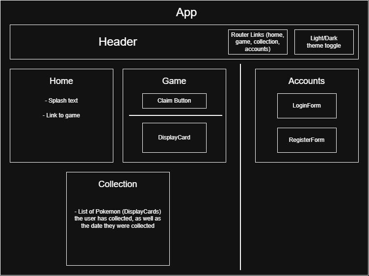

# Daily Pokémon

#### _Pokémon-based browser minigame | Hosted at https://daily-pkmn.web.app/_

#### By _**India Lyon-Myrick**_

## Technologies Used

* _Javascript_
* _React_
* _HTML_
* _CSS_
* _Webpack_
* _Node.js_
* _Git_
* _Firebase/Firestore_
* _React Router_
* _PokeAPI / PokeAPI JS Wrapper_

## Description

_A web-based minigame based on [PokeAPI](https://pokeapi.co/). Once registered, users can claim one randomly generated Pokémon per day. The app uses Firestore to keep track of users' claims, and users can view their collection at any time from the Collection page. Additionally, the site includes dark and light themes._

_Component diagram:_

#### Future Goals

* _Add authentication using a Google Account_
* _Authentication refactor using React Context_
* _Add logic to allow users to collect alternate Pokémon forms_
* _Add mobile-specific styling (refactor header and add w-50 to DisplayCards)_
* _Allow users to select their preferred theme_

## Setup/Installation Requirements

* _You will need Node.js (`https://nodejs.org/en/download/current`) to run the program._
* _Additionally, to run the program from source, you will need your own Firebase project. Google provides some instructions [here](https://firebase.google.com/docs/web/setup)._
* _Once you have a Firebase project, create a `.env` file in the root directory, and add your Firebase config object as environment variables prefixed with `REACT_APP_`, e.g. `REACT_APP_FIREBASE_API_KEY="1234567890"`._

_1: Clone the repository to a folder of choice on your machine (by either using the "Code" button on the GitHub page, or in a terminal application using `git clone https://github.com/igl-myrick/daily-pokemon`)._

_2: Using a terminal application such as Git Bash or Windows Command Prompt, navigate to the top level of the program folder and run `npm install`. This may take some time._

_3: Next, run `npm run build` to build the program._

_4: Once the program is built, run `npm run start` to open and use the program._

## Known Bugs

* _None at the moment._

## License

_[MIT](/LICENSE.md)_